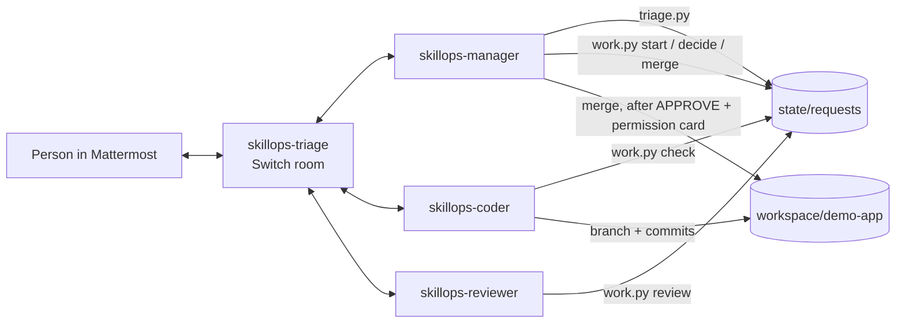

# Switch SkillOps

**A bug report posted in Mattermost becomes a tested, reviewed fix, merged only after a person approves it, with three AI agents and the person working in one Switch room.**

Built for the Flip the Switch hackathon, *Best Business Workflow* track.

## What it does

A teammate posts a bug report or feature request in the `skillops-triage` channel. Three Claude Code agents, connected through [Switch](https://github.com/sandbox-quantum/switch), take it from there, in the room:

1. **skillops-manager** triages it: a request id, type, acceptance criteria, risk, and the workflow chosen and why. If something is missing, it asks.
2. When the person says `start SKO-0001`, **skillops-coder** writes a failing regression test, fixes the bug on a branch, and posts the test evidence.
3. **skillops-reviewer**, a separate session that did not write the change, checks it against the acceptance criteria and re-runs the tests.
4. The person decides: `APPROVE SKO-0001 merge`, `CHANGES SKO-0001: <what>` or `REJECT SKO-0001`. A casual "looks good" is refused.
5. The merge itself stops at a Switch permission card in the room until the person allows it.

Every step, handoff, piece of evidence and decision is in the room's history.



Request lifecycle, enforced in code (`skillops/triage.py`):

```text
RECEIVED → TRIAGED (or NEEDS_CLARIFICATION → TRIAGED) → PLANNED → IMPLEMENTING → QA_REVIEW
→ AWAITING_HUMAN_APPROVAL → APPROVED → COMPLETED
                          ↘ CHANGES_REQUESTED → IMPLEMENTING   ↘ REJECTED
```

## Why Switch is essential

Switch is what puts the agents in the room and lets them work together there:

- **The room is the workspace.** Each agent is a Switch agent with its own Mattermost bot account in `skillops-triage`. Requests, handoffs, evidence and decisions all live in that room's history.
- **Handoffs are Switch messages.** The manager hands work to the coder, and the coder to the reviewer, with Switch targeted messages, which wake the addressed agent.
- **Shared room context.** Agents answer follow-ups without repeating context, and the room's instructions brief every agent that joins.
- **Who may instruct whom.** Switch's addressing policy ("Me and my agents") lets the agents hand work to each other while refusing anyone else.
- **Human approval in chat.** When the manager tries to merge, Claude Code's permission request reaches the room as a Switch approval card (Allow once / Allow for this session / Decline).
- **Sessions on demand.** Switch Console starts each agent's Claude Code session when the agent is addressed.

Without Switch there is no room, no handoffs between agents and no approval card: SkillOps would be three disconnected terminal sessions.

## Agents connected

| Agent | Runs | Working directory | Brief | May run |
|---|---|---|---|---|
| `skillops-manager` | Claude Code, managed agent on this computer | `agents/manager` | [CLAUDE.md](agents/manager/CLAUDE.md) | `triage.py new/show`, `work.py start/decide`; `work.py merge` only after asking |
| `skillops-coder` | Claude Code, managed agent on this computer | `agents/coder` | [CLAUDE.md](agents/coder/CLAUDE.md) | `work.py check`, git status/diff/log/add/commit in the demo repo, edits in the demo repo |
| `skillops-reviewer` | Claude Code, managed agent on this computer | `agents/reviewer` | [CLAUDE.md](agents/reviewer/CLAUDE.md) | `work.py review`, read-only git in the demo repo |

Each agent's allowed and denied commands are in its `.claude/settings.json`. All three use Auto mode on and Bypass permissions off, and answer "Me and my agents".

Debugging skills (Claude Code skills, no extra commands):

- `skillops-coder` → [debug](agents/coder/.claude/skills/debug/SKILL.md): reproduce, one hypothesis at a time, find every caller, fix at the root.
- `skillops-reviewer` → [bug-hunt](agents/reviewer/.claude/skills/bug-hunt/SKILL.md): trace edge-case inputs through the change and its other callers before a verdict.
- You, in Claude Code at the repo root → [skillops-troubleshoot](.claude/skills/skillops-troubleshoot/SKILL.md): symptom → evidence → fix for silent agents, the Mattermost bridge, wrong agent folders and `work.py` refusals.

## Room setup

One Mattermost channel, `skillops-triage`, created by the room template [switch/skillops.template.yaml](switch/skillops.template.yaml). It adds the three agents and you, sets the room instructions (how to start work and how to decide), and posts a kickoff that wakes the manager.

## Run it

Verified on Windows 11 with Switch Console 0.40.1, switch-core 0.31.0, bundled Mattermost 11.9.0, Docker Desktop 29.8 and Claude Code 2.1. See [docs/LOCAL_TEST_RESULTS.md](docs/LOCAL_TEST_RESULTS.md) for what was tested.

### Prerequisites

- [Switch Console](https://github.com/sandbox-quantum/switch/releases) (desktop app)
- Docker Desktop, running (for the bundled Mattermost)
- Claude Code, installed and signed in (`claude auth login`)
- Python 3.12+ and Git on your PATH

### 1. Get the code and reset the demo

```bash
git clone https://github.com/gaikwadashutosh35/switch-skillops.git
cd switch-skillops
python -m unittest
python skillops/work.py reset-demo
```

`reset-demo` clears all requests and recreates `workspace/demo-app`: a tiny app with one bug, on `main`, in its own git repository.

### 2. Start Switch with Mattermost

In Switch Console:

1. **Add a server → Run a server on this computer**, with *Also run Mattermost* on. Wait for *Running locally*.
2. **Settings → Agent providers**: Claude Code shows *Signed in*.
3. **Home → Mattermost row → ⋮ → Sign-in details… → Open in browser**, and sign in. Your Mattermost account is linked automatically.

### 3. Create the three agents

**Your Agents → the dashed + card**, once per agent. Set **Directory** correctly when you create the agent: a session keeps the directory it started with.

| Name | Directory | Agent instructions |
|---|---|---|
| `skillops-manager` | `<repo>/agents/manager` | `You are skillops-manager. Your full brief is CLAUDE.md in your working directory; follow it. Answer people in the Switch room, not only in your terminal.` |
| `skillops-coder` | `<repo>/agents/coder` | `You are skillops-coder. Your full brief is CLAUDE.md in your working directory; follow it.` |
| `skillops-reviewer` | `<repo>/agents/reviewer` | `You are skillops-reviewer. Your full brief is CLAUDE.md in your working directory; follow it.` |

For all three: Run location *This computer*, Agent provider *Claude Code*, the rest as default.

### 4. Create the room

**Templates → Import template →** `switch/skillops.template.yaml` **→ Save → Use → Create**. Open `skillops-triage` in Mattermost; the manager answers the kickoff.

### 5. Use it

The full scripted walkthrough is in [docs/07_DEMO_SCRIPT.md](docs/07_DEMO_SCRIPT.md). In short:

```text
@skillops-manager The settings page crashes when I save a profile with an empty optional display name. ...
@skillops-manager start SKO-0001
@skillops-manager APPROVE SKO-0001 merge
```

To run the demo again: `python skillops/work.py reset-demo`, then `!reset @skillops-manager`, `!reset @skillops-coder` and `!reset @skillops-reviewer` in the room.

## Safety model

- **Agents propose, code decides.** Risk, workflow and every status change are decided by `skillops/` code, not by the agents. Risk comes from the person's own words (deploy, production, login, token, delete, `rm -rf`, …), and an agent cannot lower it. High-risk requests go to a "stop, a person decides" workflow.
- **Two approval gates.** `work.py decide` accepts only `APPROVE SKO-xxxx merge` from a person (not an agent) while the request awaits approval. `work.py merge` refuses anything not `APPROVED`, and merges only the commit the review tested, never later commits on the branch. On top of that, the manager's merge command is set to *ask*, which shows a Switch approval card in the room.
- **No commands from chat.** A command in a message becomes text in the request, never something an agent runs. Each agent has a short allowlist in `.claude/settings.json`; git and tests run with fixed arguments and timeouts, never through a shell.
- **Evidence, not claims.** Test output is captured by `work.py`, trimmed, and redacted for token/password-like values before it reaches the room.
- **Nothing leaves the machine.** No push, no deploy; the only consequential action is a local merge in the demo repository.

More in [docs/09_SECURITY_AND_GUARDRAILS.md](docs/09_SECURITY_AND_GUARDRAILS.md) and [docs/DECISIONS.md](docs/DECISIONS.md).

## Tests

```bash
python -m unittest
```

49 tests: triage (routing, clarification, risk, malformed drafts, duplicates, state transitions, UTF-8 input) and the workflow (reproduction, QA gate, review on the right branch, approvals refused and accepted, changes, rejection, merging only the reviewed commit, secret redaction, demo reset). No dependencies outside the Python standard library.

## Repository layout

```text
agents/           one folder per Switch agent: CLAUDE.md brief, .claude/settings.json allowlist, .claude/skills
.claude/skills/   skillops-troubleshoot, for debugging the setup
skillops/         triage.py (triage, risk, routing, state) and work.py (gated workflow steps)
tests/            unit tests for both
demo/seed/        the demo app with its bug; reset-demo copies it to workspace/demo-app
switch/           the Switch room template
docs/             hackathon requirements, decisions, test results, demo script, security
state/, workspace/  runtime data (gitignored)
```

## Known limitations

- **One demo repository.** The coder works on `workspace/demo-app`, not on a project you choose, and merges are local; there is no GitHub pull request.
- **Windows setup steps.** Switch Console 0.40.1's template form could not create a new agent on Windows, so agents are created in the New agent form and the template only creates the room ([ADR-005](docs/DECISIONS.md); reported upstream as [switch#1511](https://github.com/sandbox-quantum/switch/issues/1511)).
- **Mattermost bridge after a restart.** If Mattermost comes up after the Switch server (for example after restarting Docker), the bridge crashes and does not retry. Fix: *Admin → Status →* turn the Mattermost switch off and on. Reported upstream as [switch#1510](https://github.com/sandbox-quantum/switch/issues/1510).
- **Agent directory is fixed per room session.** Editing a managed agent's Directory does not move a room session it already has, so set it when creating the agent; to fix a wrong one, recreate the agent. Reported upstream as [switch#1512](https://github.com/sandbox-quantum/switch/issues/1512).
- **The approver's name is reported by the agent.** `work.py decide` refuses agent names and requires the exact phrase, but it trusts the manager to pass the sender correctly.
- **Allow rules need a trusted folder.** Each agent's deny rules were verified to block commands (see [docs/LOCAL_TEST_RESULTS.md](docs/LOCAL_TEST_RESULTS.md)), but Claude Code ignores a project's allow rules until the folder is trusted; until then Auto mode decides on unlisted commands.
- **No cancellation command mid-work.** Use Switch's `!interrupt @skillops-coder`, then `REJECT SKO-xxxx` once it awaits a decision.
- **Open findings from fuzzing** ([details](docs/LOCAL_TEST_RESULTS.md#fuzzing-2026-11-06)): `work.py start` does not refuse a high-risk request; the "agents cannot approve" check is a plain name match (`@skillops-manager` passes); risk is a keyword list that misses wordings such as `rm -fr` or `git push --force`; and a line break in a summary can fake a status line in the room.
- **Bare orders skip triage.** "Deploy to production" was refused by the manager directly rather than routed through triage's high-risk workflow, which is covered by unit tests.

## License

[MIT](LICENSE). SkillOps uses only the Python standard library and vendors no third-party code. Switch, Mattermost and Claude Code are installed separately under their own licenses.

## Links

- Hackathon: https://www.wemakedevs.org/hackathons/switch
- Switch: https://github.com/sandbox-quantum/switch · docs: https://docs.switchagents.ai/
