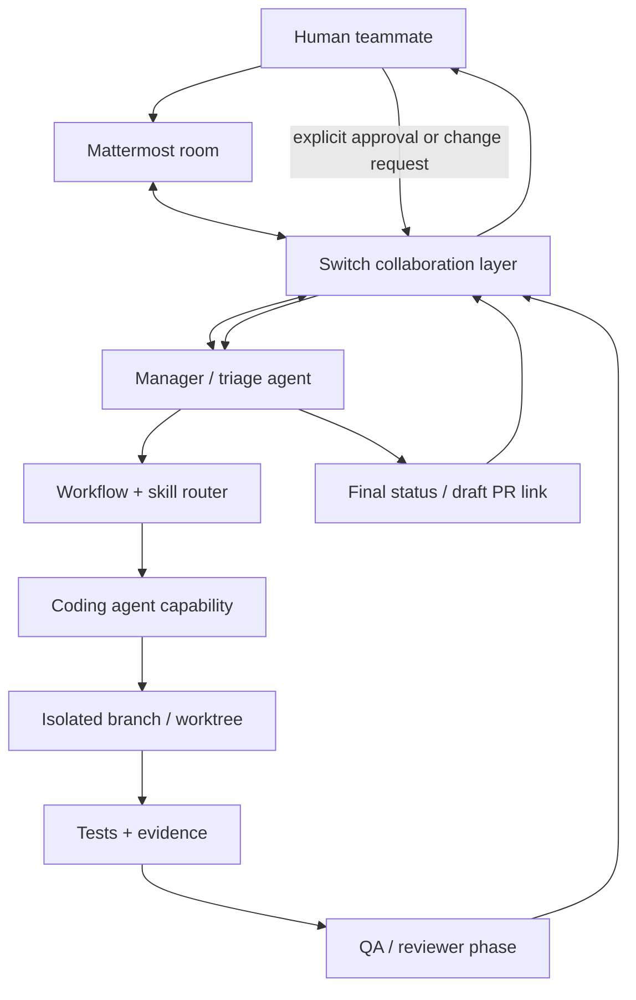
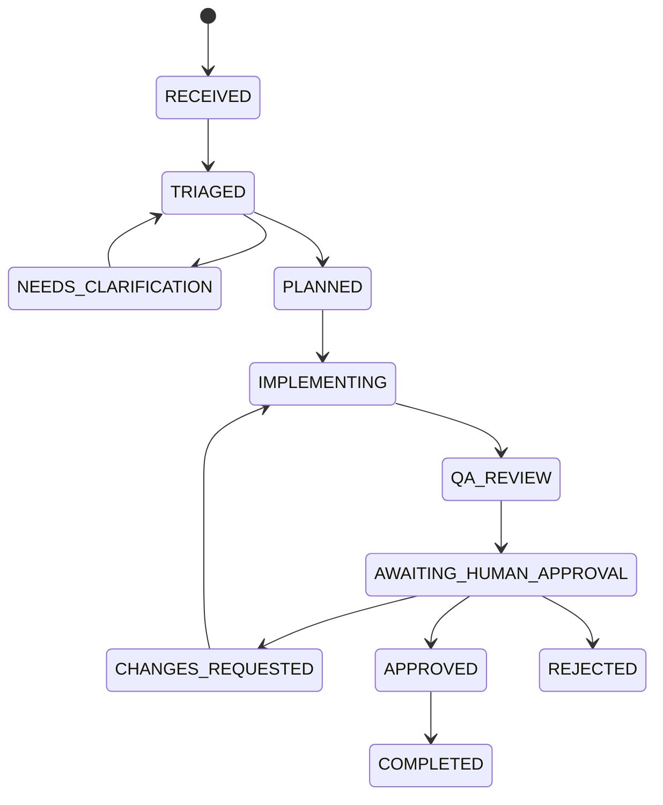

# 05 — Architecture

## High-level architecture

## Component responsibilities

### Mattermost
The human-facing team chat. It is where requests, clarification, progress, review evidence and approval are visible.

### Switch
The collaboration layer that connects the agent to the chat room and provides shared room context and agent participation. Switch is not the model provider and does not replace Mattermost.

### Manager/triage agent
Understands the request, asks clarifying questions, produces a structured plan, invokes the router and coordinates stages.

### Workflow/skill router
A small deterministic policy module. It selects a workflow based on task type and risk. It returns the workflow ID, reason and required outputs. It does not execute arbitrary commands.

### Coding capability
The existing Claude Code agent/runtime, used through the documented Switch integration. Initially this may be the same runtime as the manager, with clear phase separation; do not misrepresent prompt phases as independent agents.

### QA/reviewer phase
Checks the actual diff and test outputs against acceptance criteria. It should be independent in instruction and report findings with evidence. It may be a separate agent later if supported and justified.

### State
Prefer Switch room history as the shared conversation source. Add only minimal structured workflow state if required for reliable transitions, request IDs, deduplication and approvals. Do not build a large database prematurely.

## Workflow state model

## Why Switch is central

If Switch is removed, the intended product loses its shared room context, human/agent collaboration surface, agent participation and documented handoff mechanism. A direct webhook to Mattermost would not demonstrate the intended Switch-based workflow and should not be used as a shortcut for the core path.

## Integration strategy

- Follow the current Switch agent protocol and docs.
- Prefer Switch Console for the hackathon local setup.
- Use official supported agent connection and room configuration.
- Do not couple the product to undocumented internal database tables or private APIs.
- Keep a thin integration adapter around supported Switch interfaces so product logic is testable.
- If a separate dashboard is added, it is supplemental; Mattermost remains the primary user experience.

## Deployment shape

MVP: local Switch + bundled Mattermost + existing agent runtime + SkillOps workflow code. A judge should be able to reproduce the demo using documented prerequisites and setup steps.
